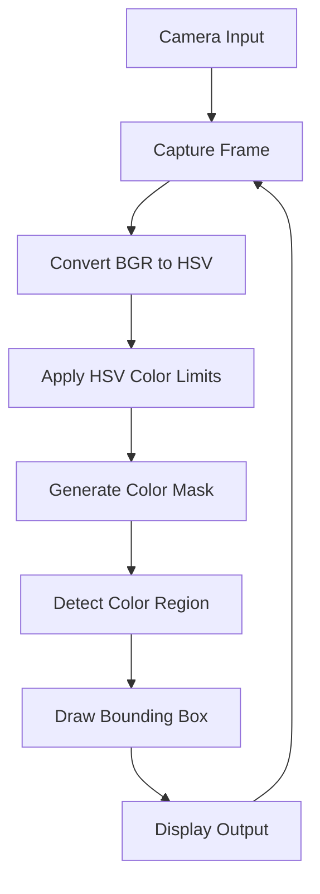

# 🎨 Real-Time Color Detection Using OpenCV

A simple computer vision project that detects specific colors in real time using Python and OpenCV. It uses HSV color processing to identify selected colors and highlights the detected regions with bounding boxes.

## 🚀 Features

- Real-time color detection.
- HSV-based color identification.
- Webcam and IP camera support.
- Bounding box visualization.
- Customizable color detection limits.

## 🏗️ System Architecture



## 🛠️ Technology Stack

- Python
- OpenCV
- NumPy
- Pillow (PIL)

## ⚙️ Installation & Execution

**1. Clone the repository**

```bash
git clone <your-repository-url>
cd ColorDETR
```

**2. Install dependencies**

```bash
pip install opencv-python numpy pillow
```

**3. Run the project**

```bash
python main.py
```

## 📂 Project Structure

```text
ColorDETR/
├── main.py
├── util.py
└── README.md
```

## 👨‍💻 Author

**Yuvaraj D**

AI & Data Science | Artificial Intelligence | Computer Vision

GitHub: [Yuvaraj471](https://github.com/Yuvaraj471)
